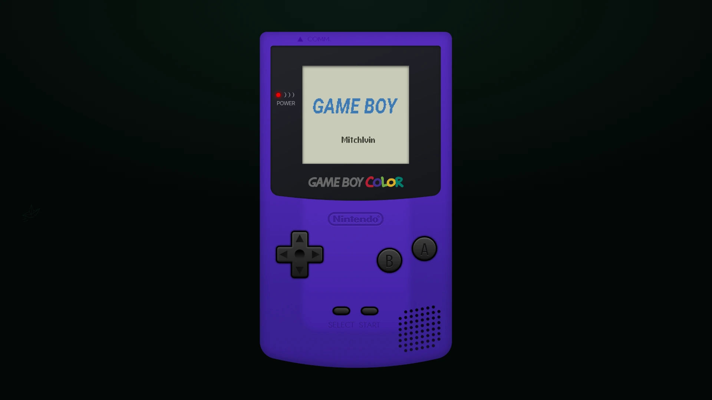
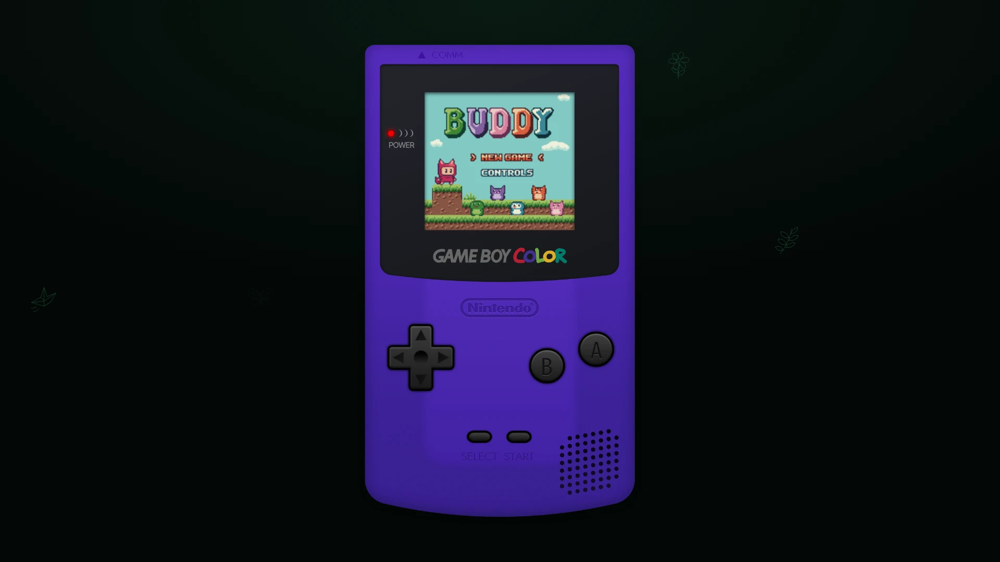

# Game Boy Color

A Game Boy Color emulator for the browser and a desktop widget for Windows, with a full handheld shell, on-device menus and sound.

**[Download for Windows](https://github.com/mitchivin/game-boy-color/releases/latest) · [Open live demo](https://mitchivin.github.io/game-boy-color/) · [Explore in DoodleDev](https://doodledev.app/builds/#game-boy-color)**

Current release: **0.0.34**. Free to use. Works on desktop and phone.

## Features

- **Playable game.** The live demo comes with BUDDY, ready to play.
- **Your own games.** In the desktop widget, choose **Games > Import Games…** to add your own.
- **Handheld controls.** Use the on-screen buttons or a keyboard, and change the keys in Keybinds.
- **Device menus.** Change settings without leaving the Game Boy Color screen.
- **Speed.** Play at 1×, 2× or 3×.
- **Right-click menu.** Right-click or long-press the device for Mute, Speed, Keybinds, Turn Off, About and GitHub.
- **Desktop widget.** On Windows it's just the device on your desktop: a see-through window you drag anywhere, with a tray icon. Your game saves when you minimise or close it. Always on Top, Minimize and Close are in the right-click menu.

## Keyboard

| Key | Button |
| --- | --- |
| Arrow keys | D-pad |
| W | A |
| Q | B |
| Alt | Start |
| Ctrl | Select |

## Get started

### Windows desktop widget

1. Download the **Setup installer** from [Releases](https://github.com/mitchivin/game-boy-color/releases/latest) and run it.
2. The installer isn't signed, so Windows may show "Windows protected your PC". Click **More info**, then **Run anyway**.
3. Play BUDDY, or choose **Games > Import Games…** to add your own.

### Browser

1. Open the [Game Boy Color live demo](https://mitchivin.github.io/game-boy-color/).
2. Start BUDDY.
3. Use the on-screen buttons or the keyboard to play.

This repository contains public product information and release downloads. The application source is not published here.

## Related

- [DoodleDev](https://github.com/mitchivin/doodledev)
- [iPod Classic](https://github.com/mitchivin/ipod-classic)
- [iPod Original](https://github.com/mitchivin/ipod-original)
- [OP-XY](https://github.com/mitchivin/te-opxy)
- [OP-1 Field](https://github.com/mitchivin/te-op1-field)
- [Frostbolt Player](https://github.com/mitchivin/frostbolt-player)
- [MitchIvin XP](https://mitchivin.com/)

## About

Built by [Mitch Ivin](https://mitchivin.com/) in [DoodleDev](https://doodledev.app/).

Game Boy Color is an independent creative project and is not affiliated with Nintendo.

Screenshots captured at 1920 × 1080.
